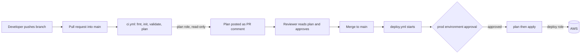

# COB Infrastructure Platform: Terraform CI/CD on AWS with GitHub Actions (OIDC)

A data platform on AWS (S3, Glue, Athena, IAM) provisioned with Terraform and delivered through a fully automated, review-gated GitHub Actions pipeline. No AWS access keys are stored anywhere: GitHub authenticates to AWS with short-lived OpenID Connect (OIDC) tokens.

## Table of contents

1. [Overview](#1-overview)
2. [Architecture](#2-architecture)
3. [Repository layout](#3-repository-layout)
4. [How the pipeline works](#4-how-the-pipeline-works)
5. [One-time setup](#5-one-time-setup)
6. [The workflows](#6-the-workflows)
7. [IAM policy reference](#7-iam-policy-reference)
8. [Testing log and issues resolved](#8-testing-log-and-issues-resolved)
9. [Troubleshooting](#9-troubleshooting)
10. [Security notes and known limitations](#10-security-notes-and-known-limitations)
11. [Adding more environments later](#11-adding-more-environments-later)
12. [Day-to-day workflow](#12-day-to-day-workflow)

---

## 1. Overview

| Item | Value |
|---|---|
| Cloud | AWS, region `us-east-1` |
| IaC | Terraform `1.14.0` |
| CI/CD | GitHub Actions |
| AWS authentication | GitHub OIDC (no stored credentials) |
| Environment | `prod` (single environment for now) |
| Resource naming | `cob-prod-*` (underscores in Glue names: `cob_prod_*`) |
| Remote state | S3 bucket `cob-remote-tfstate-bucket`, key `cob/terraform.tfstate` |
| Terraform modules | `github.com/Osakpolor23/cob_infrastructure_platform_osas/modules/{iam,s3,data_platform_services}` |

### Design goals

- **Nothing reaches AWS without review.** Code goes through a pull request, a reviewer reads the Terraform plan posted on the PR, and the deploy itself waits for a second approval.
- **Least privilege.** Two separate IAM roles: a read-only role for pull request plans and a scoped deploy role for applies.
- **No long-lived secrets.** Every AWS session is short-lived and tied to a specific repo and workflow context.

---

## 2. Architecture

### Resources deployed

| Module | Resources |
|---|---|
| `s3` | Data bucket `cob-prod-s3-bucket-<random>` with versioning, ownership controls, public access block and a lifecycle rule |
| `data_platform_services` | Glue catalog database `cob_prod_catalog_db`, Glue crawler `cob-prod-s3-crawler`, Athena workgroup `cob-prod-analytics`, Athena results bucket `cob-prod-athena-results-<random>` (public access block, expiry lifecycle rule) |
| `iam` | Glue crawler role, analysts group `cob-prod-analysts` with an inline policy, analyst users with console login profiles, group memberships, plus EC2 and ECS roles defined by the module |

### Delivery flow



### Two roles, two trust boundaries

| Role | Used by | Can be assumed from | Permissions |
|---|---|---|---|
| `github-actions-terraform-plan` | `ci.yml` (pull requests) | Any workflow run triggered by a pull request in this repo | Read-only |
| `github-actions-terraform-role` | `deploy.yml` (after merge) | Only jobs that run in the GitHub Environment `prod` | Create, update and delete the project's resources |

The deploy role's trust policy only accepts tokens issued to the `prod` environment, and that environment requires a human approval and only allows deployments from `main`.

---

## 3. Repository layout

```
.
├── .github/
│   └── workflows/
│       ├── ci.yml          # Pull request checks and plan
│       └── deploy.yml      # Plan and apply after merge, behind approval
├── infra_example/          # Terraform root configuration
│   ├── backend.tf
│   ├── main.tf             # Module calls (iam, s3_bucket, data_platform_services)
│   ├── providers.tf
│   ├── variables.tf
│   ├── terraform.tfvars    # Non-secret input values, committed on purpose
│   └── .terraform.lock.hcl # Provider lock file, committed on purpose
├── .gitignore
└── README.md
```

---

## 4. How the pipeline works

### On a pull request (`ci.yml`)

1. Check out the code and assume the **plan role** through OIDC.
2. `terraform fmt -check`, `init`, `validate`.
3. `terraform plan` against the real state, without taking the state lock (the role is read-only).
4. Post the plan as a comment on the PR.
5. Branch protection requires this check to pass and at least one approving review before the merge button works.

### After merge (`deploy.yml`)

1. A push to `main` that touches `infra_example/**` starts the workflow.
2. The job declares `environment: prod`, so it **pauses until a required reviewer approves**.
3. After approval, assume the **deploy role** through OIDC.
4. `init`, `validate`, `plan -out=tfplan`, write the plan to the run summary, then `apply tfplan`. Applying the saved plan guarantees Terraform applies exactly what it just planned.

A `concurrency` group queues deploys one at a time and never cancels one in progress.

---

## 5. One-time setup

### 5.1 Create the GitHub OIDC provider in AWS

AWS Console, then **IAM → Identity providers → Add provider**:

| Field | Value |
|---|---|
| Provider type | OpenID Connect |
| Provider URL | `https://token.actions.githubusercontent.com` |
| Audience | `sts.amazonaws.com` |

AWS validates GitHub's certificate against its own trusted CA library, so the thumbprint is filled in automatically.

### 5.2 Understand the OIDC subject (`sub`) claim

The trust policy of each role decides who may assume it by matching the token's `sub` claim. The subject depends on how the job runs:

| Job type | `sub` |
|---|---|
| Job with `environment: prod` | `repo:<OWNER>@<OWNER_ID>/<REPO>@<REPO_ID>:environment:prod` |
| Pull request job (no environment) | `repo:<OWNER>@<OWNER_ID>/<REPO>@<REPO_ID>:pull_request` |

In this repo, tokens carry the numeric owner and repository IDs after the names (for example `repo:Osakpolor23@<OWNER_ID>/cob_infrastructure_platform_with_CI-CD@<REPO_ID>:pull_request`). This ties the trust to the exact account and repository, so a renamed or recreated lookalike repository cannot assume your roles. **Always copy the subject from what your tokens actually carry** (see [Troubleshooting](#9-troubleshooting)), not from a format you read in documentation.

#### How to find the GitHub IDs

- Owner ID: open `https://api.github.com/users/<OWNER>` and read `id`.
- Repository ID: open `https://api.github.com/repos/<OWNER>/<REPO>` and read `id`.

### 5.3 Create the deploy role: `github-actions-terraform-role`

Trusted entity type: **Web identity**, provider `token.actions.githubusercontent.com`, audience `sts.amazonaws.com`. Then edit the trust policy:

```json
{
  "Version": "2012-10-17",
  "Statement": [
    {
      "Effect": "Allow",
      "Principal": {
        "Federated": "arn:aws:iam::<ACCOUNT_ID>:oidc-provider/token.actions.githubusercontent.com"
      },
      "Action": "sts:AssumeRoleWithWebIdentity",
      "Condition": {
        "StringEquals": {
          "token.actions.githubusercontent.com:aud": "sts.amazonaws.com",
          "token.actions.githubusercontent.com:sub": "repo:<OWNER>@<OWNER_ID>/<REPO>@<REPO_ID>:environment:prod"
        }
      }
    }
  ]
}
```

Attach three customer-managed policies (full JSON in [section 7](#7-iam-policy-reference)):

| Policy | Purpose |
|---|---|
| `tf-backend` | Read and write the Terraform state file and lock file |
| `tf-data-platform` | S3, Glue and Athena resources for the platform |
| `tf-iam` | The IAM roles, group and users the modules create |

**Naming rule:** the deploy role must not start with `cob-prod-`. `tf-iam` is scoped to `cob-prod-*` roles, so a deploy role outside that prefix cannot modify its own permissions.

### 5.4 Create the plan role: `github-actions-terraform-plan`

Same provider, but the trust policy accepts pull request jobs:

```json
{
  "Version": "2012-10-17",
  "Statement": [
    {
      "Effect": "Allow",
      "Principal": {
        "Federated": "arn:aws:iam::<ACCOUNT_ID>:oidc-provider/token.actions.githubusercontent.com"
      },
      "Action": "sts:AssumeRoleWithWebIdentity",
      "Condition": {
        "StringEquals": {
          "token.actions.githubusercontent.com:aud": "sts.amazonaws.com",
          "token.actions.githubusercontent.com:sub": "repo:<OWNER>@<OWNER_ID>/<REPO>@<REPO_ID>:pull_request"
        }
      }
    }
  ]
}
```

Attach one policy: `tf-plan-readonly` (read-only; see section 7).

### 5.5 Configure the GitHub Environment `prod`

Repository, then **Settings → Environments → New environment**, named exactly `prod`:

| Setting | Value |
|---|---|
| Required reviewers | At least one collaborator |
| Deployment branches and tags | **Selected branches and tags**, rule `main` |
| Allow administrators to bypass | Off once testing is finished |
| Environment variables | `AWS_ROLE_ARN` = deploy role ARN, `AWS_REGION` = `us-east-1` |
| Secrets | None needed (OIDC) |


### 5.6 Add repository variables for CI

**Settings → Secrets and variables → Actions → Variables → Repository variables**:

| Name | Value |
|---|---|
| `AWS_PLAN_ROLE_ARN` | `arn:aws:iam::<ACCOUNT_ID>:role/github-actions-terraform-plan` |
| `AWS_REGION` | `us-east-1` |

These must be **repository-level**, because the CI job has no `environment:` and therefore cannot read environment variables.

### 5.7 Protect the `main` branch

**Settings → Branches** (or **Rules → Rulesets**) for `main`:

| Rule | Setting |
|---|---|
| Require a pull request before merging | On, **1 required approval** |
| Dismiss stale approvals when new commits are pushed | On |
| Require conversation resolution | On |
| Require status checks to pass | On, required check: **`Format, Validate and Plan`**, source **GitHub Actions** |
| Require branches to be up to date before merging | On |
| Block force pushes | On |
| Allow bypassing / include administrators | Off once a second reviewer exists |

The required check name must match the job's `name:` in `ci.yml` exactly.

### 5.8 Terraform configuration

- **Backend:** S3 bucket `cob-remote-tfstate-bucket`, key `cob/terraform.tfstate`. The `tf-backend` policy allows the `.tflock` object next to the state file, which assumes S3 native locking (`use_lockfile = true`, Terraform 1.10 or newer).
- **Inputs:** `infra_example/terraform.tfvars` sets `environment = "prod"` plus `project_name`, `bucket_name`, `iam_group` and `iam_users`. The IAM policies match the resulting names (`cob-prod-*`), so a different `environment` value will fail with `AccessDenied`.
- **Provider lock file:** generate it with checksums for every platform that runs Terraform. Both workflows use `-lockfile=readonly`, so they fail without it.

  ```bash
  cd infra_example
  terraform init
  terraform providers lock -platform=linux_amd64 -platform=windows_amd64
  ```

  Add `-platform=darwin_arm64` for Apple Silicon Macs.

### 5.9 `.gitignore`

```gitignore
*.tfstate
*.tfstate.*
*.tfplan
tfplan
plan.txt
crash.log
.terraform/
```

Do **not** ignore `terraform.tfvars` or `.terraform.lock.hcl`.

---

## 6. The workflows

### `ci.yml` (pull requests)

| Property | Value |
|---|---|
| Trigger | `pull_request` into `main`, for changes under `infra_example/**` and the workflow files |
| Required check name | `Format, Validate and Plan` |
| Permissions | `id-token: write`, `contents: read`, `pull-requests: write` |
| AWS role | `vars.AWS_PLAN_ROLE_ARN` (read-only) |
| Concurrency | Per pull request, cancels outdated runs |

| Step | What it does |
|---|---|
| Checkout | Fetches the repo |
| Configure AWS Credentials | Assumes the plan role through OIDC |
| Setup Terraform | Installs `1.14.0` without the wrapper script |
| Terraform Format | `fmt -check -recursive -diff` fails on unformatted code |
| Terraform Init | `init -input=false -lockfile=readonly` connects to the S3 backend and enforces locked provider versions |
| Terraform Validate | Checks syntax and internal consistency |
| Terraform Plan | `plan -lock=false -no-color`, output saved to `plan.txt`. `-lock=false` because the read-only role cannot write the lock file |
| Post plan to PR | Posts `plan.txt` as a PR comment (truncated at 60,000 characters) |

### `deploy.yml` (after merge)

| Property | Value |
|---|---|
| Trigger | `push` to `main` for changes under `infra_example/**` and `deploy.yml`, plus manual `workflow_dispatch` |
| Environment | `prod` (approval gate) |
| Permissions | `id-token: write`, `contents: read` |
| AWS role | `vars.AWS_ROLE_ARN` (deploy role) |
| Concurrency | Group `terraform-prod`, `cancel-in-progress: false` |

| Step | What it does |
|---|---|
| Checkout, Configure AWS Credentials, Setup Terraform | As above, with the deploy role |
| Terraform Init, Validate | Connects to the backend, checks the config |
| Terraform Plan | `plan -lock-timeout=5m -out=tfplan` (the deploy role can write the lock) |
| Show Plan in Run Summary | Writes `terraform show` output to the run's summary page |
| Terraform Apply | `apply tfplan`. A saved plan needs no `-auto-approve` and is rejected as stale if anything changed in between |

---

## 7. IAM policy reference

Replace `<ACCOUNT_ID>`. Names assume `project_name = cob`, `environment = prod` and the usernames in `terraform.tfvars`.

<details>
<summary><strong><code>tf-backend</code></strong> (deploy role): Terraform state</summary>

```json
{
  "Version": "2012-10-17",
  "Statement": [
    {
      "Sid": "ListStateBucket",
      "Effect": "Allow",
      "Action": "s3:ListBucket",
      "Resource": "arn:aws:s3:::cob-remote-tfstate-bucket"
    },
    {
      "Sid": "ReadWriteState",
      "Effect": "Allow",
      "Action": ["s3:GetObject", "s3:PutObject", "s3:DeleteObject"],
      "Resource": [
        "arn:aws:s3:::cob-remote-tfstate-bucket/cob/terraform.tfstate",
        "arn:aws:s3:::cob-remote-tfstate-bucket/cob/terraform.tfstate.tflock"
      ]
    }
  ]
}
```
</details>

<details>
<summary><strong><code>tf-data-platform</code></strong> (deploy role): S3, Glue, Athena</summary>

```json
{
  "Version": "2012-10-17",
  "Statement": [
    {
      "Sid": "ManageDataAndResultsBuckets",
      "Effect": "Allow",
      "Action": [
        "s3:CreateBucket", "s3:DeleteBucket", "s3:ListBucket",
        "s3:GetBucketLocation", "s3:GetBucketTagging", "s3:PutBucketTagging",
        "s3:GetBucketPolicy", "s3:GetBucketAcl", "s3:GetBucketCORS",
        "s3:GetBucketWebsite", "s3:GetBucketVersioning", "s3:PutBucketVersioning",
        "s3:GetAccelerateConfiguration", "s3:GetBucketRequestPayment",
        "s3:GetBucketLogging", "s3:GetLifecycleConfiguration", "s3:PutLifecycleConfiguration",
        "s3:GetReplicationConfiguration", "s3:GetEncryptionConfiguration",
        "s3:PutEncryptionConfiguration", "s3:GetBucketObjectLockConfiguration",
        "s3:GetBucketPublicAccessBlock", "s3:PutBucketPublicAccessBlock",
        "s3:GetBucketOwnershipControls", "s3:PutBucketOwnershipControls"
      ],
      "Resource": "arn:aws:s3:::cob-prod-*"
    },
    {
      "Sid": "EmptyResultsBucketOnDestroy",
      "Effect": "Allow",
      "Action": ["s3:GetObject", "s3:DeleteObject"],
      "Resource": "arn:aws:s3:::cob-prod-athena-results-*/*"
    },
    {
      "Sid": "GlueDatabaseAndCrawler",
      "Effect": "Allow",
      "Action": [
        "glue:CreateDatabase", "glue:GetDatabase", "glue:UpdateDatabase", "glue:DeleteDatabase",
        "glue:GetTables", "glue:GetTable", "glue:DeleteTable",
        "glue:CreateCrawler", "glue:GetCrawler", "glue:UpdateCrawler", "glue:DeleteCrawler",
        "glue:TagResource", "glue:UntagResource", "glue:GetTags"
      ],
      "Resource": [
        "arn:aws:glue:us-east-1:<ACCOUNT_ID>:catalog",
        "arn:aws:glue:us-east-1:<ACCOUNT_ID>:database/cob_prod_catalog_db",
        "arn:aws:glue:us-east-1:<ACCOUNT_ID>:table/cob_prod_catalog_db/*",
        "arn:aws:glue:us-east-1:<ACCOUNT_ID>:crawler/cob-prod-s3-crawler"
      ]
    },
    {
      "Sid": "AthenaWorkgroup",
      "Effect": "Allow",
      "Action": [
        "athena:CreateWorkGroup", "athena:GetWorkGroup",
        "athena:UpdateWorkGroup", "athena:DeleteWorkGroup",
        "athena:TagResource", "athena:UntagResource", "athena:ListTagsForResource"
      ],
      "Resource": "arn:aws:athena:us-east-1:<ACCOUNT_ID>:workgroup/cob-prod-analytics"
    }
  ]
}
```

Bucket names end in a random suffix chosen at apply time, which is why the S3 ARNs use `cob-prod-*`. Many `Get...` actions are needed only because the Terraform AWS provider reads every bucket attribute on each refresh.
</details>

<details>
<summary><strong><code>tf-iam</code></strong> (deploy role): roles, group, users</summary>

```json
{
  "Version": "2012-10-17",
  "Statement": [
    {
      "Sid": "ManageModuleRoles",
      "Effect": "Allow",
      "Action": [
        "iam:CreateRole", "iam:GetRole", "iam:DeleteRole",
        "iam:UpdateAssumeRolePolicy", "iam:TagRole", "iam:UntagRole",
        "iam:ListRolePolicies", "iam:ListAttachedRolePolicies",
        "iam:ListInstanceProfilesForRole",
        "iam:PutRolePolicy", "iam:GetRolePolicy", "iam:DeleteRolePolicy"
      ],
      "Resource": [
        "arn:aws:iam::<ACCOUNT_ID>:role/cob-prod-glue-crawler-role",
        "arn:aws:iam::<ACCOUNT_ID>:role/cob-prod-public-ec2-role",
        "arn:aws:iam::<ACCOUNT_ID>:role/cob-prod-private-ec2-role",
        "arn:aws:iam::<ACCOUNT_ID>:role/cob-prod-ecs-execution-role",
        "arn:aws:iam::<ACCOUNT_ID>:role/cob-prod-ecs-task-role"
      ]
    },
    {
      "Sid": "AttachGlueServiceRoleOnly",
      "Effect": "Allow",
      "Action": ["iam:AttachRolePolicy", "iam:DetachRolePolicy"],
      "Resource": "arn:aws:iam::<ACCOUNT_ID>:role/cob-prod-glue-crawler-role",
      "Condition": {
        "ArnEquals": {
          "iam:PolicyARN": "arn:aws:iam::aws:policy/service-role/AWSGlueServiceRole"
        }
      }
    },
    {
      "Sid": "AttachSsmCore",
      "Effect": "Allow",
      "Action": ["iam:AttachRolePolicy", "iam:DetachRolePolicy"],
      "Resource": [
        "arn:aws:iam::<ACCOUNT_ID>:role/cob-prod-public-ec2-role",
        "arn:aws:iam::<ACCOUNT_ID>:role/cob-prod-private-ec2-role"
      ],
      "Condition": {
        "ArnEquals": {
          "iam:PolicyARN": "arn:aws:iam::aws:policy/AmazonSSMManagedInstanceCore"
        }
      }
    },
    {
      "Sid": "AttachEcsExecutionPolicy",
      "Effect": "Allow",
      "Action": ["iam:AttachRolePolicy", "iam:DetachRolePolicy"],
      "Resource": "arn:aws:iam::<ACCOUNT_ID>:role/cob-prod-ecs-execution-role",
      "Condition": {
        "ArnEquals": {
          "iam:PolicyARN": "arn:aws:iam::aws:policy/service-role/AmazonECSTaskExecutionRolePolicy"
        }
      }
    },
    {
      "Sid": "PassCrawlerRoleToGlue",
      "Effect": "Allow",
      "Action": "iam:PassRole",
      "Resource": "arn:aws:iam::<ACCOUNT_ID>:role/cob-prod-glue-crawler-role",
      "Condition": {
        "StringEquals": { "iam:PassedToService": "glue.amazonaws.com" }
      }
    },
    {
      "Sid": "ManageAnalystsGroup",
      "Effect": "Allow",
      "Action": [
        "iam:CreateGroup", "iam:GetGroup", "iam:DeleteGroup",
        "iam:ListGroupPolicies",
        "iam:PutGroupPolicy", "iam:GetGroupPolicy", "iam:DeleteGroupPolicy"
      ],
      "Resource": "arn:aws:iam::<ACCOUNT_ID>:group/cob-prod-analysts"
    },
    {
      "Sid": "ManageUsersAndLoginProfiles",
      "Effect": "Allow",
      "Action": [
        "iam:CreateUser", "iam:GetUser", "iam:DeleteUser",
        "iam:TagUser", "iam:UntagUser", "iam:ListUserTags",
        "iam:ListGroupsForUser",
        "iam:CreateLoginProfile", "iam:GetLoginProfile",
        "iam:UpdateLoginProfile", "iam:DeleteLoginProfile"
      ],
      "Resource": [
        "arn:aws:iam::<ACCOUNT_ID>:user/John-analyst",
        "arn:aws:iam::<ACCOUNT_ID>:user/Richard-analyst",
        "arn:aws:iam::<ACCOUNT_ID>:user/Jane-analyst"
      ]
    },
    {
      "Sid": "GroupMembership",
      "Effect": "Allow",
      "Action": ["iam:AddUserToGroup", "iam:RemoveUserFromGroup"],
      "Resource": [
        "arn:aws:iam::<ACCOUNT_ID>:group/cob-prod-analysts",
        "arn:aws:iam::<ACCOUNT_ID>:user/John-analyst",
        "arn:aws:iam::<ACCOUNT_ID>:user/Richard-analyst",
        "arn:aws:iam::<ACCOUNT_ID>:user/Jane-analyst"
      ]
    }
  ]
}
```

Security properties of this policy:

- `AttachRolePolicy` is pinned by condition to the specific AWS-managed policies the modules use, so the deploy role cannot attach `AdministratorAccess` to anything.
- `PassRole` is limited to the crawler role and the Glue service.
- Group membership is scoped to the analysts group, so the role cannot add a user to an admin group.
- Users are listed by exact name, never `user/*`. Adding an analyst means adding their ARN to the two user statements first.
</details>

<details>
<summary><strong><code>tf-plan-readonly</code></strong> (plan role): read-only</summary>

```json
{
  "Version": "2012-10-17",
  "Statement": [
    {
      "Sid": "ReadState",
      "Effect": "Allow",
      "Action": "s3:GetObject",
      "Resource": "arn:aws:s3:::cob-remote-tfstate-bucket/cob/terraform.tfstate"
    },
    {
      "Sid": "ListStateBucket",
      "Effect": "Allow",
      "Action": "s3:ListBucket",
      "Resource": "arn:aws:s3:::cob-remote-tfstate-bucket"
    },
    {
      "Sid": "ReadBuckets",
      "Effect": "Allow",
      "Action": [
        "s3:ListBucket", "s3:GetBucketLocation", "s3:GetBucketTagging",
        "s3:GetBucketPolicy", "s3:GetBucketAcl", "s3:GetBucketCORS",
        "s3:GetBucketWebsite", "s3:GetBucketVersioning",
        "s3:GetAccelerateConfiguration", "s3:GetBucketRequestPayment",
        "s3:GetBucketLogging", "s3:GetLifecycleConfiguration",
        "s3:GetReplicationConfiguration", "s3:GetEncryptionConfiguration",
        "s3:GetBucketObjectLockConfiguration", "s3:GetBucketPublicAccessBlock",
        "s3:GetBucketOwnershipControls"
      ],
      "Resource": "arn:aws:s3:::cob-prod-*"
    },
    {
      "Sid": "ReadGlue",
      "Effect": "Allow",
      "Action": [
        "glue:GetDatabase", "glue:GetTables", "glue:GetTable",
        "glue:GetCrawler", "glue:GetTags"
      ],
      "Resource": [
        "arn:aws:glue:us-east-1:<ACCOUNT_ID>:catalog",
        "arn:aws:glue:us-east-1:<ACCOUNT_ID>:database/cob_prod_catalog_db",
        "arn:aws:glue:us-east-1:<ACCOUNT_ID>:table/cob_prod_catalog_db/*",
        "arn:aws:glue:us-east-1:<ACCOUNT_ID>:crawler/cob-prod-s3-crawler"
      ]
    },
    {
      "Sid": "ReadAthena",
      "Effect": "Allow",
      "Action": ["athena:GetWorkGroup", "athena:ListTagsForResource"],
      "Resource": "arn:aws:athena:us-east-1:<ACCOUNT_ID>:workgroup/cob-prod-analytics"
    },
    {
      "Sid": "ReadIam",
      "Effect": "Allow",
      "Action": [
        "iam:GetRole", "iam:ListRolePolicies", "iam:ListAttachedRolePolicies",
        "iam:GetRolePolicy", "iam:ListInstanceProfilesForRole",
        "iam:GetGroup", "iam:ListGroupPolicies", "iam:GetGroupPolicy",
        "iam:GetUser", "iam:ListUserTags", "iam:ListGroupsForUser",
        "iam:GetLoginProfile"
      ],
      "Resource": [
        "arn:aws:iam::<ACCOUNT_ID>:role/cob-prod-glue-crawler-role",
        "arn:aws:iam::<ACCOUNT_ID>:role/cob-prod-public-ec2-role",
        "arn:aws:iam::<ACCOUNT_ID>:role/cob-prod-private-ec2-role",
        "arn:aws:iam::<ACCOUNT_ID>:role/cob-prod-ecs-execution-role",
        "arn:aws:iam::<ACCOUNT_ID>:role/cob-prod-ecs-task-role",
        "arn:aws:iam::<ACCOUNT_ID>:group/cob-prod-analysts",
        "arn:aws:iam::<ACCOUNT_ID>:user/John-analyst",
        "arn:aws:iam::<ACCOUNT_ID>:user/Richard-analyst",
        "arn:aws:iam::<ACCOUNT_ID>:user/Jane-analyst"
      ]
    }
  ]
}
```

There are no create, put, delete, attach or pass-role actions, and no write access to the state bucket. That is why the CI plan runs with `-lock=false`.
</details>

---

## 8. Testing log and issues resolved

The pipeline was tested end to end on its first pull request. These are the problems encountered, in order, and how each was resolved.

| # | Where | Symptom | Cause | Fix |
|---|---|---|---|---|
| 1 | PR #3, `Configure AWS Credentials` | `Not authorized to perform sts:AssumeRoleWithWebIdentity`, retried about a dozen times | The plan role's trust policy matched `repo:<OWNER>/<REPO>:pull_request`, but the tokens carry the numeric owner and repository IDs in the subject | Used CloudTrail (`AssumeRoleWithWebIdentity` event) to read the identity AWS recorded, then updated the trust policy to the ID-based subject. Re-ran the failed job |
| 2 | First `deploy.yml` run, `terraform apply` | `AccessDenied` on S3, Glue and IAM create calls for `cob-dev-*` resources | `terraform.tfvars` had `environment = "dev"` while every IAM policy was scoped to `cob-prod-*` | Set `environment = "prod"` and shipped it through a normal pull request. A re-run of the failed job cannot fix this, because it replays the original commit |
| 3 | Same run | `AccessDenied` creating the EC2 and ECS roles | The shared `iam` module also defines EC2 and ECS roles, which `tf-iam` did not cover | Extended `tf-iam` to the five roles the module creates, with managed-policy attachments pinned per role |
| 4 | Second `deploy.yml` run | Everything created except one resource: `NoSuchEntity: The group with name cob-prod-analysts cannot be found` | A race. The group membership for one user was created in parallel with the group itself, and the module does not declare the dependency | Re-run the deploy (Terraform had saved the successful resources, so only the missing membership is planned). Permanent fix: added `depends_on = [aws_iam_group.analysts]` to `aws_iam_user_group_membership.user_groups` in the module |

After fix 4 the apply creates the S3 buckets and their configuration, the Glue database and crawler, the Athena workgroup, the IAM roles and inline policies, the analysts group and the group memberships.

### Verification checklist

- [ ] PR opened, `Format, Validate and Plan` check passes
- [ ] Plan comment appears on the PR with only `+ create` lines and no `- destroy`
- [ ] Reviewer approves, PR merges
- [ ] `deploy.yml` pauses for the `prod` approval, then applies successfully
- [ ] A follow-up plan reports no changes (`No changes. Your infrastructure matches the configuration.`)
- [ ] `depends_on` fix merged in the `iam` module

---

## 9. Troubleshooting

| Symptom | Likely cause | What to do |
|---|---|---|
| `Not authorized to perform sts:AssumeRoleWithWebIdentity` | The role's trust policy `sub` does not match the token, the role ARN variable is wrong, or the role does not exist | In CloudTrail, open the failed `AssumeRoleWithWebIdentity` event (Event history, same region) and compare the recorded identity with the trust policy. Or add a temporary step that decodes the token's `sub`. Also check the repo and environment variable values |
| `Input required and not supplied: role-to-assume` | The variable is empty, or it lives at the wrong level (environment instead of repository) | Define `AWS_PLAN_ROLE_ARN` at repository level |
| `AccessDenied ... no identity-based policy allows the X action` | The role is missing an action, a policy is not attached, or resource names do not match the policy (for example `dev` vs `prod`) | Read the action and resource in the error, add only that action to the right policy, and check the role's **Permissions** tab |
| `Failed to read variables file` | `terraform.tfvars` is not committed (often hidden by `.gitignore`) | Remove the ignore rule and commit the file |
| Provider lock or checksum errors in `init` | `.terraform.lock.hcl` is missing or lacks `linux_amd64` checksums | Run `terraform providers lock -platform=linux_amd64 -platform=windows_amd64` and commit |
| `Would reformat` | Unformatted `.tf` files | Run `terraform fmt -recursive` and commit |
| Required check stays "Expected" forever | The `paths` filter skipped the workflow (for example a README-only PR) while the check is required | Remove the `paths:` block from `ci.yml`, or accept an admin override for docs-only PRs |
| "Saved plan is stale" on apply | State or infrastructure changed between plan and apply | Re-run the deploy |
| `terraform destroy` fails on a bucket | The bucket is not empty | Set `force_destroy = true` on the **results** bucket only (the policy already allows object deletion there) |
| Re-running a failed job repeats the same error after pushing a fix | Re-runs replay the original commit | Start a new run from the fixed commit (new push, or **Actions → Run workflow**) |

---

## 10. Security notes and known limitations

**Controls in place**

- No stored AWS credentials. Sessions are short-lived and bound to the repository, and the deploy role only accepts the `prod` environment.
- A human reviews the plan on the PR, and a human approves the deploy. The environment only accepts deployments from `main`.
- The deploy role cannot grant itself or anyone else more power: attachments are pinned to specific managed policies, IAM resources are scoped by name, and the role's own name is outside the managed prefix.
- The CI role is read-only. It cannot create, change or delete anything.

**Known limitations and recommendations**

- **State contains sensitive values.** Console passwords generated for the analyst users are stored in the Terraform state. Keep `cob-remote-tfstate-bucket` private, encrypted and tightly restricted. Anyone who can open a PR in this repository can run workflow code with the read-only plan role, which can read state, so only grant write access to trusted collaborators.
- **Public repository.** Workflows, `terraform.tfvars` and policies are visible. Account IDs are not secrets, but make sure `terraform.tfvars` contains nothing sensitive.
- **One state file.** `cob/terraform.tfstate` holds a single environment. Do not deploy another `environment` value against it, or Terraform will plan to destroy the existing resources.
- **Plan comments accumulate.** Each push to a PR adds a new comment. If this gets noisy, switch to the job summary or update a single comment.
- **Only `us-east-1`** is covered by the Glue and Athena ARNs.

---

## 11. Adding more environments later

Do this **before** the first non-prod deploy:

1. **Separate state per environment.** Remove `key` from the backend block and pass it at init:
   `terraform init -backend-config="key=cob/${ENV}/terraform.tfstate"`
   Move the existing `cob/terraform.tfstate` to `cob/prod/terraform.tfstate` first (copy it in S3, then `terraform init -migrate-state`), or Terraform will start from empty state.
2. **One GitHub Environment per environment** (`dev`, `staging`, `prod`), each with its own `AWS_ROLE_ARN` and `AWS_REGION` variables, and reviewers on the ones that need a gate.
3. **One deploy role per environment**, each with trust subject `...:environment:<env>` and policies scoped to `cob-<env>-*` and `cob/<env>/*`.
4. **Pass the environment** to Terraform (`-var="environment=<env>"` or a per-environment tfvars file), and make the concurrency group dynamic (`terraform-<env>`).
5. Extend the plan role's read permissions to the new names.

The Terraform modules do not change, because every name derives from `var.environment`.

---

## 12. Day-to-day workflow

```bash
git checkout main && git pull
git checkout -b my-change

# edit files under infra_example/
terraform -chdir=infra_example fmt -recursive

git add .
git commit -m "Describe the change"
git push -u origin my-change
```

1. Open a pull request into `main`.
2. Wait for `Format, Validate and Plan` to pass and read the plan comment.
3. Ask a collaborator to review and approve.
4. Merge. Approve the `prod` deployment when prompted.
5. Open the run's **Summary** to see the plan that was applied.